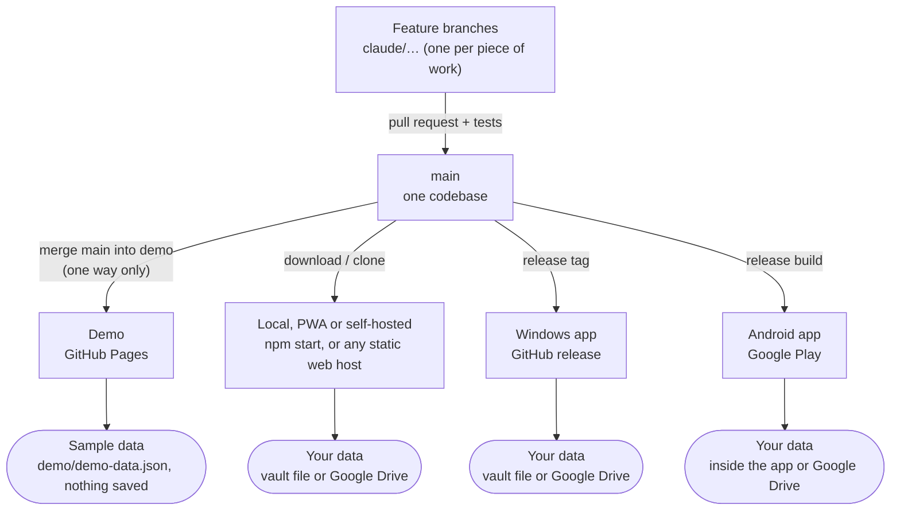

# Personal Financial Dashboard

A private, local-first dashboard for your money: **accounts and insurance, property, portfolio and retirement planning**, with an encrypted vault you
keep in a file or in your own Google Drive. One codebase (React 18 + Vite, no server) runs as a **web app**, an installable **PWA**, a **Windows app**
(Electron) and an **Android app** (Capacitor). Nothing is sent to a server of ours, and there is a public **demo** with sample data.

> **Status: pre-release.** Everything is covered by unit tests and browser tests, but Google sign-in, Google Drive, the Windows `.exe` and the Android app
> have only been tested against stand-ins for Google and the devices, not on a real account or phone. Tell me about anything odd.

## Contents

[Get it running](#get-it-running) · [The screen flow](#sign-in-and-storage-the-same-screen-flow-on-every-version) · [Tabs](#tabs) · [Your data and privacy](#how-your-data-is-stored-finance-property-portfolio-and-retirement) ·
[Google Drive](#google-drive-storage-optional) · [Google setup](#google-setup) · [AI chat](#ai-chat-optional-your-own-claude-key) · [Home settings](#home-settings-weather-and-the-market-ticker) ·
[Android](#android-app) · [Windows](#windows-app-electron) · [Run as an app](#run-as-an-app-windows-no-exe) · [Demo site](#demo-site-github-pages) · [Branches](#how-the-branches-work) ·
[Development](#development) · [Making a release](#making-a-release) · [Credits](#credits)

## Get it running

| You want | Do this |
|---|---|
| **Try it** (sample data, nothing saved) | Open the demo site (GitHub Pages, published from the `demo` branch) and choose **Continue without signing in**. |
| **Use it on your computer** | Install [Node.js](https://nodejs.org) 18+, then `npm install` and `npm start`, and open <http://localhost:4173>. |
| **Use it as its own window (Windows, no .exe)** | Double-click **`Run as app.cmd`**, or install it from the browser. See [Run as an app](#run-as-an-app-windows-no-exe). |
| **Windows program** | Download the portable `.exe` or installer from a [release](../../releases) (unsigned: SmartScreen asks once). See [Windows app](#windows-app-electron). |
| **Android** | Build it in Android Studio. See [Android app](#android-app). |

```bash
git clone https://github.com/saurskr/personal-financial-dashboard   # or download the ZIP from GitHub and unzip it
cd personal-financial-dashboard
npm install        # once
npm start          # builds the app and serves it; then open http://localhost:4173 in your browser
```

Stop it with `Ctrl+C`. If port 4173 is busy use `npm start -- --port 5000` (the address matters for Google sign-in, because Google remembers it).
**Hosting it elsewhere:** `npm run build` writes a static site to `dist/`; upload that folder to any static host over HTTPS.

## Sign-in and storage: the same screen flow on every version

The top bar has **Save** (writes the encrypted vault now; in a browser that cannot write the file in place it downloads the encrypted file) and **Logout** (saves, then locks and signs out; if the save fails it tells you why and lets you stay or log out anyway). The old "file · encrypted · saved" strip is gone; a message only appears when something needs action (reconnect Google Drive, a conflict, a failed save).

Demo site, web, installed web app, Windows app and Android app all open the same way:

**1. Sign in → 2. Where should your data live? → 3. Unlock (only if a vault already exists) → 4. Home.** Every sign-in lands on Home.

1. **Sign in** is always the first screen. **Sign in with Google** (behind the quick check) opens Google's page; once it is done you go to step 2.
   **Continue without signing in** logs you in as **Demo User**: sample data, a *Demo Mode* banner ("Change anything you like: it stays in this
   session and is gone when you reload. Nothing is saved or sent."), and no saving. On the demo site the Google button is greyed out; the screen is
   otherwise identical. A copy built without a Google client ID greys it out too, and says why.
2. **Where should your data live?** (after Google sign-in): **Vault file** (Android: inside the app; Windows and web: a `.wvault` file in a
   folder you choose, remembered) or **Google Drive**. After *Continue without signing in* both are greyed out and only
   **Demo mode – nothing will be saved** works. There are no save options on the Assets tab any more.
3. **Unlock:** if a vault is already remembered on this device, signing in goes straight to the passphrase.
4. **Home:** always the landing page. (The Finance tab is now **💲 Assets**.)

| | Web / installed web app | Windows app | Android app |
|---|---|---|---|
| **Sign in with Google** | Google's page | opens your browser | the phone's Google account |
| **Vault file** | a folder you choose, remembered | a folder you choose, exact path remembered | kept inside the app |
| **Google Drive** | yes | yes | yes |

- **Nothing about who you are is stored.** Name and email live in memory for the session, so closing the app signs you out. Quiet sign-in at start
  (web) only works if Google already has you signed in. Your data is protected by its own passphrase either way.
- **Settings → Account & sign-in:** in demo mode it offers **Sign in with Google**. Signing in there shows "Where should your data live?" and
  **your demo changes go into the vault you choose** (nothing is saved until you choose). Once a vault is in use you see where it lives and can
  **move** it. **Google connection** shows only **Use my own…** (your own Google client ID, kept in this browser, never displayed; the form has a small
  link to go back to the app's own). The two-step verification preview has been removed.
- **Moving between Vault file and Google Drive** (Settings → Your data & security → *Move your data*): the encrypted vault is copied, the copy is read
  back and checked, and only then does the app switch. **The old copy is never deleted for you.** A notice says exactly where it still is and that it
  is no longer updated, with **Delete old copy…** (asks you to confirm; a Drive copy goes to the Drive bin) or **Keep it, stop reminding me**.
- **Danger zone → Wipe data…** (type WIPE): resets the vault and erases the data in its current storage (the app's vault file, the chosen
  `.wvault` file, or the Google Drive file, permanently), forgets it on this device, and returns to "Where should your data live?". The unlock screen
  has the same thing as *Forgot the passphrase? Wipe data…*. An old copy left by an earlier move is not touched.
- **Code:** `src/lib/channel.js` (the choices), `src/lib/nativegoogle.js` (Android), `src/lib/googleauth.js`, `src/auth/` (sign-in), `src/finance/Gate.jsx`
  (Where-to-save and unlock), `src/settings/SettingsPage.jsx`.

## Tabs

- **Home** – the landing page. A rolling **market ticker** (always visible; dashes until prices load), a **Total net worth** card on the
  left (choose All, Mine, Me + Others, Spouse or Parent; everything converted into your first country's currency; needs your vault unlocked),
  and on the right one compact block per country you selected in Settings → Countries: the **city of its main stock exchange**, the **time**
  (AM/PM with a day or night icon), **market open/closed** (or when it opens) and the **weather**. See "Home settings" below.
- **Retirement** – one page. The left column starts with your **saved plans** (up to three small square-ish tiles side by side within the column's width; click a tile to choose
  one; the highlighted one is the plan you are on, and under the tiles it has Save changes, Rename and Delete; an empty "+" tile saves your current inputs as another plan), then the **inputs** (your situation including
  contribution growth, *Savings used* picked from Finance asset accounts, *Inheritance*, *Income in retirement* with the **insurance survivor benefit**
  tick-box, and market conditions with a staleness warning; the savings and inheritance sections fold to a one-line summary). The **chance of success**
  (with On track / Off track at your target, 85% by default) spans the width of the other two columns. Under it, in the middle: **results** (nest egg
  needed, projected balance, surplus or shortfall, extra saving needed) and **monthly income, planned vs projected**; on the right: the **charts**
  (**Projected Net Worth**, **Chance your savings last**, and folded: when it runs out, the 10-year-yield sensitivity table and a comparison of the saved plans).
  *Advanced* (volatility, correlations,
  the spending rule, target chance, number of runs and the seed) is under the columns. On a phone the order is plans, chance of success, results, charts, inputs.
  The simulation is 1,000 to 10,000 random futures in today's money (lognormal real returns per asset class, correlated, rebalanced yearly). The
  starting return, volatility and correlation figures are **placeholders, not forecasts**; edit them. **Inheritance** is a flat amount added to your
  savings in the calendar year you enter, exactly as typed (not inflation-adjusted); past years and years after the plan-to age are ignored. The
  **insurance survivor benefit** adds the **value at maturity** of your Assets insurance policies (not their death benefit) to the nest egg at retirement. A saved plan stores its
  inputs and seed, and results are recalculated when you open it. Engine: `src/lib/montecarlo.js`; plan and saved plans: `src/lib/retirement.js`;
  screens: `src/retirement/`. Not included in the Excel export.
- **Property** – properties by country with a value history you enter (USA has an "Open on Zillow" link for
  looking up the Zestimate yourself), manually recorded mortgages (balance, principal, interest, escrow) with the **time remaining** on each,
  equity and loan-to-value, reminders for mortgage payments, property tax and **home insurance renewal**, and monthly charts.
  Under each loan, a **payoff calculator** (amortization schedule) starts from the recorded loan and lets you try a different rate or payment and **extra payments**
  (monthly, once a year, or one-time lumps): it shows the payoff date, the time and interest saved, a balance chart and the full schedule. Scenarios are not saved.
  Each property can also hold its **home insurance**: insurer, policy number, premium, deductible, renewal date, and **coverage limits** (dwelling, other structures,
  personal property, loss of use, liability, medical payments, plus your own lines), with a warning if the dwelling limit is below the rebuild cost you entered.
  Not counted in the Assets totals. Zillow has no public API and forbids scraping, so values are typed in.
- **Portfolio** – holdings per portfolio (stocks, ETFs, funds, bonds, cash) with prices you type in, linked to
  one of your Assets accounts: that account's balance is then calculated from the holdings, and Retirement uses their mix.
  **Add holding** starts with the ticker or symbol; "Look up" fills the name, type and currency from Alpha Vantage (free key under Settings → Home; the free
  tier allows 25 requests a day, and the dialog shows how many you have used and says so plainly when the limit is reached).
  **Upload holdings…** reads a CSV or Excel (.xlsx) file: it guesses the columns (you can change them), makes **one portfolio per country** (or one per **Account name** if the file has that column, named after it, with an Assets account of the same name), asks whether
  this is **Update and overwrite** or a **New addition**, shows exactly what will change, and applies it only when you confirm. Allocation by asset class, sector, geography and portfolio, a single-stock concentration warning,
  stale-price flags, a bulk "Update prices" screen, and class-level rebalancing with a buy-only plan for new money.
  When you link an account, a difference between its typed balance and your holdings is added as an
  "unallocated" holding by default (or you accept the new total).
- **💲 Assets** (the Finance part of the app) – assets, liabilities and insurance by country (USA, India, UK, Ireland,
  Australia or Switzerland; **one list** in Settings is used by every tab), with an owner filter (Mine / Me + Others / Spouse / Parent), a month-by-month chart and a Performance panel per country.
  **Upload accounts…** reads a CSV or Excel file the same way (columns guessed, a default value per field, Update and overwrite or New addition, preview, confirm). There is no asset-mix field any more.
  The combined total across countries is on Home.
- **🧾 Tax residency** (shown only when both USA and India are in your countries list) – enter your tax residency as **date ranges**: US *Resident* or *Nonresident*
  (tax year 1 January to 31 December) and India *NRI*, *RNOR* or *ROR* (tax year 1 April to 31 March). One bar per country on a shared timeline, with each country's
  tax-year ticks, a marker and a list at every date the status changes, and today's status. Colours: Resident and ROR orange, Nonresident and RNOR green, NRI light green.
  The ranges are included in the Excel export and import. Statuses are what you enter; the residency tests themselves are not calculated.
- **⚙ Settings** (the gear, far right) – one page for everything: *Account & sign-in* (sign in, your own Google client, sign out), *AI assistant*, countries and display,
  *Your data & security* (where the vault lives, move it, passphrase, **recovery key**, auto-lock, Excel export and import), *Home* (weather and prices), *Property*, *Portfolio*,
  and a **Danger zone** (Wipe data). *This device* shows the version, the install button and where your data is.

## How your data is stored (Finance, Property, Portfolio and Retirement)

**Forgot the passphrase?** In Settings → Your data & security, press *Make a recovery key*. It is shown once (26 letters and digits). Keep it somewhere other than the vault.
On the lock screen, *Forgot the passphrase? Use your recovery key…* opens the vault with it and sets a new passphrase. Without a recovery key a forgotten passphrase cannot be reset.
Files use format `WVLT2` (a random data key, stored once under the passphrase and once under the recovery key); older `WVLT1` files still open and are upgraded on the next save.

**Number fields** show thousands separators as you type (1,250,000); the stored value is always the plain number.

- Everything lives in one encrypted file (`*.wvault`), created and opened from the app. Nothing is
  sent to a server. Full account and policy numbers are stored in it.
- Encryption is AES-256-GCM with a key derived from your passphrase (PBKDF2-SHA256, 600k
  iterations). The passphrase is never stored. **If you lose it, the file cannot be recovered.**
- Chrome/Edge save straight back to the file. Other browsers open via a file picker and save by
  downloading the encrypted file.
- Settings → *Export decrypted Excel copy* writes a plain, **unencrypted** workbook
  (`Items`, `Insurance`, `Balances`, `Rates`, `Property`, `PropertyValues`, `Loans`, `LoanUpdates`, `Portfolios`, `Holdings`, `Settings` sheets). Settings → *Import from Excel*
  reads that same layout.
- The exchange rate is fetched live from the Frankfurter API (ECB rates); only the two currency
  codes are sent. The rate in use is saved with each update.
- `*.wvault`, `*.xlsx`, `*.xls` and `*.csv` are git-ignored so personal data is never committed.

**What can leave your device** (nothing else does; there is no server of ours and no analytics):

| What | Goes to | When |
|---|---|---|
| The encrypted vault file | your own Google Drive | only if you choose Google Drive |
| Your Google name and email (read, not stored) | nothing: kept in memory for the session | when you sign in with Google |
| Two currency codes | Frankfurter (ECB rates) | when rates are needed |
| City coordinates | Open-Meteo | for the weather on Home |
| Ticker symbols and your key | FCS API or Alpha Vantage | only if you add a market-data key |
| The messages you type in the chat | Anthropic, with your key | only if you add a Claude key and confirm; never any vault data |

## Google Drive storage (optional)

You can keep the **encrypted** file in your own Google Drive, so it is on every device you sign in to. It is one choice next to *Vault file*, never
required, and the same on the web, the Windows app and the Android app (not the demo). It needs a Google client ID (the built-in one, or your own; see the next section) whose
Google Cloud project has the **Google Drive API** enabled.

- **Start screen:** **Create in Google Drive** creates the encrypted file in your Drive (the app refuses if one already exists, so nothing is
  overwritten by mistake); **Open from Google Drive** opens the one this app saved before. From **Settings → Your data & security** you can
  **Move to Google Drive…** or **Move to a vault file…** (see above: the old copy stays until you delete it).
- **What leaves your device:** only the encrypted file (`WealthTracker.wvault`). The passphrase and your data never do. The app asks Google for
  the **`drive.file`** scope: it can only see files this app created, nothing else in your Drive, and it can't read your mail or contacts.
  The file is visible in My Drive, so you can see it, download it, or restore an earlier version there.
- **Nothing secret is stored:** Google's access pass lives in memory for about an hour. The web version renews it quietly while Google still has you
  signed in; the **Windows and Android apps cannot renew quietly**, so after about an hour of use the status bar shows **Reconnect Google Drive**
  (one click; your changes are kept meanwhile). Only the file's id and name are remembered on this device, to find it next time.
- **If a save cannot reach Drive** (the pass ran out, or you are offline) your changes stay in the open app and the status bar says so, with a
  **Reconnect Google Drive** button. Keep the app open until it says saved.
- **Two devices:** a save first checks the file has not changed since you opened it. If another device saved in between, nothing is
  overwritten: you choose **Keep my changes** (replace the Drive copy) or **Use the Drive version** (drop yours).
- **Tested with a stand-in for Google and Drive**, not against a real account, and **the Android and Windows Drive paths have not been run on a real phone or PC**, so tell me about anything odd.

### Android: Google Cloud setup (once)

The phone's Google account (Credential Manager) checks the app itself, so Android needs **one more OAuth client** in the same Google Cloud project:

1. **Credentials → Create credentials → OAuth client ID → Android.** Package name `io.github.saurskr.dashboard` (change it if you changed the app id), and the **SHA-1
   fingerprint** of the key the app is signed with. For a debug build (Android Studio Run): `keytool -list -v -keystore %USERPROFILE%\.android\debug.keystore -alias androiddebugkey -storepass android -keypass android` (Windows).
   A release build or the Play Store build has its own fingerprint: add it as another Android client.
2. **Keep the Web client** you already have (the built-in `VITE_GOOGLE_CLIENT_ID`): the app passes it to Google as the *web client ID* alongside the Android client.
3. Enable the **Google Drive API**, and while the consent screen is in *Testing* add your Google account as a **test user**.
4. Changes in Google Cloud can take up to a few hours. If sign-in fails with *"Google does not recognise this Android app yet"* (Google error 28444), the
   package name or fingerprint does not match: check them in Logcat (filter `GoogleProvider`, it prints both).

The app's `MainActivity.java` is changed so the sign-in plugin can ask for the Drive permission; `npm run android:sync` keeps the plugin wired in.

## Google setup

The app ships with a **built-in Google client ID** (`VITE_GOOGLE_CLIENT_ID` in `.env`), so on the published site, the local app and the launcher you
just click **Sign in with Google**: nothing to set up. A client ID is public by design, and Google only accepts it from the addresses registered
for it in Google Cloud, so shipping it is safe. It never needs a client *secret* or an API key, and the app refuses to accept a secret.

- **Your own client ID instead:** **Settings → Account → Use my own…** (it is saved in the browser only). Do this if you host your own copy at a
  different address, or you want your own Google project. The form has a 6-step guide, the address to authorise, and a Copy button. Authorise
  the address you use under **Authorized JavaScript origins** (`http://localhost:4173` for the local app and launcher, your site address for a
  hosted copy), or **Authorized redirect URIs** `http://localhost:53682/oauth-callback` for the Windows app. For Google Drive storage also enable
  the **Google Drive API** in that project.
- **Without Google:** **Continue without signing in** (demo mode). In Settings → Account, **Use my own…** replaces the built-in client ID (its form can go back
  to the app's own). The demo site has no Google sign-in.
- **Shipping without a built-in ID:** empty `VITE_GOOGLE_CLIENT_ID` in `.env`; Google sign-in is then greyed out (demo mode still works) until someone adds their own client ID under Settings → Account → Use my own….
  (`npm run build:nodefault` builds that way into `dist-nodefault`; `npm run test:e2e:flow` uses it.)
- **While your Google project is in "Testing"** only the test users you listed can sign in; publish the consent screen to open it to anyone (no review
  is needed for the scopes used here).

## AI chat (optional, your own Claude key)

**Ask AI** in the top bar opens a chat drawer (full screen on a phone), set up like the home inventory app's Claude option: **bring your own Anthropic key**,
saved on this device only, calls go **straight from the app to api.anthropic.com** (no server of ours), and you confirm before anything is sent. The home
inventory app has no chat (its AI reads one photo or receipt), so the chat itself is new here.

- **Settings → AI assistant:** paste your key (checked for shape only) and pick a model (`claude-haiku-5-5` by default, `claude-sonnet-5-5` is smarter and costs
  more; any model name works). **Test the key** sends one tiny message; **Remove key** deletes it. The key is **write-only**: once saved it is never shown again.
  It is kept in this browser's IndexedDB on this device, **not** in your vault, a backup or the Excel export, and not in localStorage.
- **What is sent:** only the messages you type, to Anthropic, with your key. **Nothing from your vault** (no accounts, balances, plans or policies) is ever included,
  and the assistant is told it cannot see them. The first message of each session asks you to confirm. The last 20 messages are sent for context, and an
  answer is capped at 1,024 tokens. Anthropic bills your key by use.
- **The conversation** lives in memory only: it is cleared by **New chat**, by locking, by signing out and by reloading. Answers stream in; **Stop** cancels one.
  Escape (and the Android Back button) close the drawer.
- **Errors in plain words,** as in home inventory: cannot reach Anthropic, key rejected, unknown model, rate or spending limit.
- **Not on the demo site** (no button, no settings). It works in the web, Windows and Android versions the same way (a direct call from the app's window).
- **Code:** `src/lib/aichat.js` (request, streaming, errors), `src/lib/aikey.js` (where the key lives), `src/lib/aistore.js` (the conversation),
  `src/ai/` (drawer, settings). Tests: `test/aichat.test.js` and `npm run test:e2e:ai` (Anthropic stood in for; **not run against the real API**).

## Home settings: weather and the market ticker

Open **Settings → Home** (the ⚙ tab). Everything there is kept in this browser (not in the encrypted file), so Home works before
you unlock your data. It persists between visits on this device but is **not encrypted**.

- **Weather and air quality** use [Open-Meteo](https://open-meteo.com) (free, no key) for the city where each country's main stock
  exchange is (New York, Mumbai, London, Sydney, Zurich). The coordinates are built in, so only those are sent. The temperature unit is
  automatic (°F in the US, °C elsewhere) unless you choose one. AQI is the US air quality index and is left out when there is no data.
- **Market data provider** (web and Android; pick one in Home settings, you bring your own key, none is built in):
  - **Alpha Vantage** (free key from alphavantage.co): index prices through ETF stand-ins, labelled on the ticker (S&P 500 as SPY, Nasdaq as
    QQQ, Nifty 50 as Nifty BeES, FTSE 100 as ISF, SMI as EWL). No Sensex, ASX 200, gold or Bitcoin. A free key allows 25 requests a day, so
    it refreshes every 6, 12 or 24 hours (each refresh uses up to 5 requests) and the last prices are kept if the limit is hit.
  - **FCS API** (below).
- **Market ticker** uses [FCS API](https://fcsapi.com). Paste your key and press **Test**. It shows S&P 500, Nasdaq, Sensex and Nifty 50,
  one main index for each other country in Settings → Countries (FTSE 100, ASX 200, SMI), gold (XAU/USD) and Bitcoin (BTC/USD).
  - **Plans:** FCS's free plan (500 calls a month) covers **gold and Bitcoin only**. **Index prices need an FCS stock plan** (from about
    $25 a month). With a free key the ticker still shows gold and Bitcoin and says why the indices are missing.
  - **Calls:** a refresh makes at most 3 calls (indices, gold, Bitcoin). Prices are cached and refreshed every 30 minutes by default
    (15/30/60 in settings), only while the page is visible, and indices only while one of their markets is open.
- **Market open/closed** is calculated from each exchange's regular hours and time zone. **Public holidays are not included**, so a
  holiday can show as open.
- The FCS symbols are in one file, `src/lib/ticker.js`.

## Android app

The Android app is this same web app packaged with [Capacitor](https://capacitorjs.com) (one codebase). **Your data is kept in the app's own private
storage by default, and Google Drive is an optional second choice** (the same two choices as every other version). The project is in `android/`.

**What you need:** [Android Studio](https://developer.android.com/studio) (it brings its own JDK and the Android SDK) and Node.js
**22 or newer** (Capacitor 8's tooling; the web app itself only needs 18).

```bash
npm install
npm run android:sync     # builds the web app and copies it into android/
npm run android:open     # opens the project in Android Studio; press Run to start it on an emulator or a plugged-in phone
```

After changing the web app, run `npm run android:sync` again before Run.

- **What is different in the app:** it opens on the same sign-in screen as every other version, then "Where should your data live?" (*Vault file*,
  kept inside the app, or *Google Drive*), then Home; and Settings → *Your data* has **Export backup…** (the phone's share sheet),
  *Last backup* (a reminder), **Restore…** (asks first, and only a valid backup ever replaces the vault) and **Delete…** (you must
  type DELETE). The Back button closes a dialog, then goes to Home, then leaves the app. The app locks itself when you come back after
  longer than your auto-lock time. Home's weather and prices need internet.
- **Where the data is:** one encrypted vault file in the app's private folder (not visible to other apps or the file manager), saved safely
  (a complete temporary copy is written first, so a crash mid-save cannot lose it). **Uninstalling the app or clearing its data deletes
  it**, so use *Export backup* now and then; backups are encrypted. Android's automatic cloud backup is switched off for the app.
- **App id:** `io.github.saurskr.dashboard` (in `capacitor.config.json` and `android/app/build.gradle`). Change both before publishing if
  you want a different one: Google Play never lets it change after release.
- **Icon and splash screen:** a simple placeholder drawn in the app's colours. Replace `assets/icon-only.png`, `icon-foreground.png` and
  `icon-background.png` (1024×1024) and run `npm run android:assets`.
- **Release to Google Play:** in Android Studio, *Build → Generate Signed App Bundle*. Create a signing key once and **keep it safe and
  out of git**; losing it means you cannot update the app.
- **Tests:** the app behaviour (first launch, create, relaunch and unlock, backup, restore, delete, Back button, lock after time away) is
  covered by `npm run test:e2e:android`, which runs the real screens against an in-memory stand-in for the phone's folder, share sheet and
  Back button, and by unit tests for the storage.
- **Status:** the project and the web side are tested, but the app has **not yet been run on a device by this repository's authors** (the first Android Studio
  builds have been tried), so expect a first round of fixes. The Gradle message about `flatDir` is removed from the app module; a copy in Capacitor's generated
  Cordova module may still print it, and is harmless. Things only a real phone can show: the edge-to-edge layout
  around the notch and gesture bar, the share sheet, and the file chooser for restoring.

## Windows app (Electron)

The same app as a Windows program: a **portable `.exe`** (nothing to install) and an **installer**. It is the normal web app in its own
window, plus a small file bridge, so it saves straight into your encrypted data file with ordinary Open / Save dialogs and remembers
the file for next time (you only type the passphrase). Everything is in `electron/`.

- **Get the .exe:** on GitHub go to **Actions → Build Windows app → Run workflow**, then download `windows-app` from the finished run.
  Pushing a tag such as `v1.0.1` also attaches the files to a release. Or build it yourself: `npm install`, then `npm run win:build`;
  the files appear in `release/` (`FinanceDashboard-<version>-portable.exe` and the installer).
- **Try it without packaging:** `npm run win:dev` builds the web app and opens it in Electron.
- **Windows warning:** the files are not code-signed, so SmartScreen says "Windows protected your PC" the first time: **More info →
  Run anyway**. Signing needs a paid certificate.
- **Data:** only in the file you choose (the app never uploads it). The last file's path is remembered in the app's own settings folder.
  The page can only read or write files you picked in a dialog.
- **Google sign-in in this app** opens your normal browser (Google does not allow sign-in inside an app's own window). The app runs on
  the fixed address `http://localhost:53682`. In Google Cloud, on your **Web application** client, add
  `http://localhost:53682/oauth-callback` under **Authorized redirect URIs** (Settings → Account → Use my own… shows it and has a Copy button).
  If another program already uses port 53682 the app says so and does not start.
- **Tests:** `npm test` (server, sign-in return, file allow-list) and, on Linux with a virtual screen,
  `npm run build && xvfb-run -a npm run test:e2e:windows` runs the real Electron app. The packaged `.exe` has not been run on a real
  Windows machine in development, so tell me about anything odd.

## Run as an app (Windows, no .exe)

Two ways to get the app in its own window with no tabs and no address bar. Neither is an `.exe`, so Smart App Control has nothing to block.

- **Double-click launcher (the local version).** Install [Node.js](https://nodejs.org) (LTS) once, then double-click **`Run as app.cmd`** in
  the project folder. The first run installs what the app needs and builds it; then your Edge (or Chrome) opens the app in its own window on
  `http://localhost:4173`. **Close the window to stop it.** Run `npm run shortcut` once to put a **Finance Dashboard** shortcut (with the app
  icon) on your Desktop and in the Start menu. Details: it keeps its own browser profile (so the app remembers your settings and your data
  file separately from your normal browsing), a second double-click reuses the running copy, and `node scripts/run-as-app.mjs --port 5000`,
  `--rebuild` and `BROWSER_PATH` / `BROWSER_ARGS` let you change the port, rebuild, or pick the browser.
- **Install from the browser (any address).** Open the web app (your own copy or the demo) in Edge or Chrome and use **Settings → This
  device → Install as app** (or the install icon in the address bar). You get a Start-menu and taskbar icon, a quick start, and it opens even
  without a connection (a small service worker keeps this app's own files; it never touches your data, prices, weather or Google).
  Not offered inside the Windows or Android apps.

For Google sign-in, authorise the address you use (`http://localhost:4173` for the launcher), as in "Google setup" below.

## Demo site (GitHub Pages)

The public site is a **demo** with made-up sample data from `demo/demo-data.json`. The sign-in screen is the same as everywhere, with Google
sign-in greyed out; **Continue without signing in** opens demo mode (Demo User, a *Demo Mode* banner). The app is fully editable, nothing is saved, and a reload resets it.

- Demo mode is a build setting in this same codebase (`VITE_DEMO=true`, set by `.env.demo`), not a copy of the app:
  `npm run dev:demo` to try it locally, `npm run build:demo` to build it (into `dist-demo/`).
- `.github/workflows/pages.yml` runs the tests, builds the demo and publishes it **when the `demo` branch is updated**.
  `main` never publishes. To refresh the showcase: merge `main` into `demo` (one way only).
- To change the sample data, edit `demo/build-demo-data.mjs` and run `node demo/build-demo-data.mjs` (it uses the app's own
  functions, so the file always matches the data model). Dates are moved forward each time the demo opens so it never looks stale.
- **Demo ticker prices** come straight from FCS API. The page asks FCS for a 24-hour token using only the **public** key in `.env.demo`
  (`VITE_FCS_PUBLIC_KEY`; it is public by design and only works from websites you list). One-time setup in the FCS dashboard:
  **Security → Allowed Domains (Public Key)**: add `saurskr.github.io` (and `localhost` to try it locally) and set **Token Expiry** to
  86400. No secret key is used anywhere. Each visit costs about four FCS calls (token + one per price group), and the free plan has 500 a
  month, so a busy demo can run out (the ticker then says so). Index prices need an FCS stock plan; on a free key only gold and Bitcoin appear.
- One-time setup: repository **Settings → Pages → Build and deployment → Source: GitHub Actions**. The site is then at
  `https://<user>.github.io/<repo>/`. Assets use relative paths (`base: './'`), so any build works at a sub-path or any static host.
- `.github/workflows/ci.yml` runs the tests and both builds on every pull request and push to `main`.

## How the branches work

**One codebase, several deployments, each with its own data storage.**



| Deployment | Built from | Data lives in |
|---|---|---|
| **Local, PWA or self-hosted** | `main` (download it, or host it anywhere) | a vault file you keep, or your own Google Drive |
| **Demo** | `demo`, updated from `main`, published by the workflow | sample data in `demo/demo-data.json`; nothing saved; Google sign-in greyed out |
| **Windows app** | `main`, on a release tag | a vault file you choose, or your own Google Drive |
| **Android** | `main`, built in Android Studio | a vault file inside the app, or your own Google Drive |

- New work starts from `main` on its own branch and returns by pull request. Code flows **one way** into `demo`, never back.
- Demo mode, the vault file and Google Drive are settings inside `main`, not separate copies of the app.
- Google sign-in on Android uses a client ID registered for the Android app, in addition to the web one (see [Google Drive](#google-drive-storage-optional)).

A picture version of this, which also ships with the site, is in
[`public/docs/branch-flow.html`](public/docs/branch-flow.html) (served at `/docs/branch-flow.html`).

## Phone layout

On a phone-sized screen the app shows a simpler layout: tighter spacing, tables keep only name, owner, amount and actions,
Retirement stacks as plans, results, charts, then inputs, with the detailed assumptions folded away.

## Country flags

Windows has no flag emoji of its own (it shows letters such as "US"), so the app bundles a small font that only covers the flag characters
(`src/assets/TwemojiCountryFlags.woff2`, used first in `--font` in `src/theme.css`). Twemoji graphics © Twitter, licensed CC-BY 4.0; font packaging by TalkJS (MIT).

## Development

- `npm run dev` (live reload), `npm run dev:demo` (demo mode), `npm run build`, `npm run build:demo` (into `dist-demo/`), `npm run build:nodefault` (a build with no built-in Google client ID).
- **Unit tests:** `npm test` (about 220 tests: encryption, data model, retirement and Monte Carlo engines, Drive and Claude clients, Electron bridge, ...).
- **Browser tests** (Playwright + Chromium; each starts its own preview server). Build first, then:

```bash
npm run build && npm run build:nodefault
npm run test:e2e && npm run test:e2e:countries && npm run test:e2e:property && npm run test:e2e:portfolio && npm run test:e2e:retirement
npm run test:e2e:home && npm run test:e2e:flow && npm run test:e2e:drive && npm run test:e2e:ai && npm run test:e2e:pwa && npm run test:e2e:android
xvfb-run -a npm run test:e2e:windows      # runs the real Electron app (needs a virtual screen on Linux)
npm run build:demo && npm run test:e2e:demo
```

- **CI:** `.github/workflows/ci.yml` runs the unit tests and both builds on every pull request and push to `main`; the browser tests are run by hand.
- **Layout:** `src/lib/` pure logic (tested), `src/finance`, `src/property`, `src/portfolio`, `src/retirement`, `src/home`, `src/settings`, `src/auth`, `src/ai` screens,
  `electron/` the Windows app, `android/` the Capacitor project, `demo/` sample data, `public/` the PWA files, `scripts/` the launcher and tools, `test/` unit and browser tests.
- **Adding a tab:** add an entry to `TABS` in `src/App.jsx`.
- **The version number** lives only in `package.json` (shown in Settings → This device).
- **Conventions:** new work starts from `main` on its own branch and returns by pull request; the mockup comes before the UI code; colours come from `src/theme.css` (the PMO Hub tokens).

## Making a release

1. Make sure CI is green on `main` and run the browser tests above. Bump the version: `npm version minor` (or `patch`/`major`), which edits `package.json` and `package-lock.json`.
2. Push the tag: `git push origin main --follow-tags`. The **Build Windows app** workflow builds the portable `.exe` and the installer and attaches them to a
   GitHub release for that tag (with generated notes). You can also run it by hand from the Actions tab.
3. **Android:** `npm run android:sync`, then in Android Studio **Build → Generate Signed App Bundle** (keep the signing key safe and out of git). Raise `versionCode` and `versionName` (now 2 and 1.0.1)
   in `android/app/build.gradle` for each Play upload, and add the release key's SHA-1 as another Android OAuth client (see [Google Drive](#google-drive-storage-optional)).
4. **Demo site:** merge `main` into `demo` (one way); the Pages workflow republishes it.
5. Before announcing: check the known limits in the status note above, and that `.env` holds only the public Google client ID (no secrets are in this repository).

## Credits

[Open-Meteo](https://open-meteo.com) (weather), [Frankfurter](https://frankfurter.dev) (exchange rates), [FCS API](https://fcsapi.com) and [Alpha Vantage](https://www.alphavantage.co) (optional market data),
[Anthropic](https://www.anthropic.com) (optional chat), [Capacitor](https://capacitorjs.com), [Electron](https://www.electronjs.org), [ExcelJS](https://github.com/exceljs/exceljs),
[Twemoji](https://github.com/twitter/twemoji) flag graphics (CC-BY 4.0, packaged as a font by TalkJS). Licensed under the [MIT License](LICENSE).
