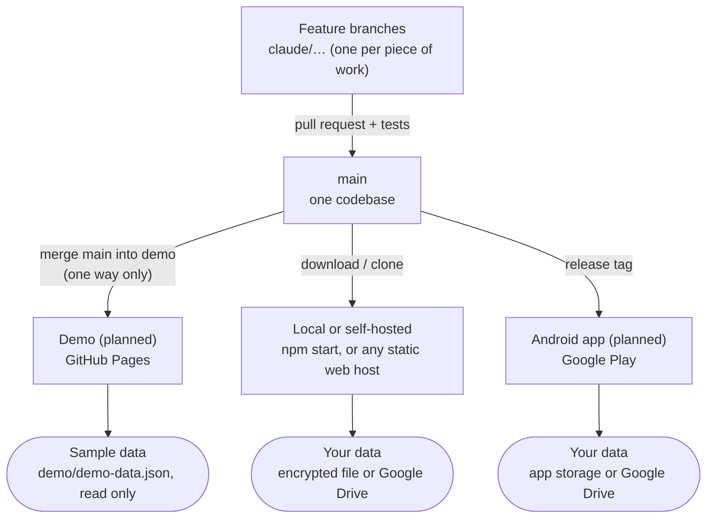

# Personal Financial Dashboard

A personal dashboard built step by step with React + Vite. Each section is a top-level tab
(add new ones in the `TABS` list in `src/App.jsx`).

## Run it on your own computer

You need [Node.js](https://nodejs.org) 18 or newer (free). Nothing else is installed and nothing is sent to a server.

```bash
git clone https://github.com/saurskr/personal-financial-dashboard   # or download the ZIP from GitHub and unzip it
cd personal-financial-dashboard
npm install        # once
npm start          # builds the app and serves it; then open http://localhost:4173 in your browser
```

Stop it with `Ctrl+C`. Run `npm start` again whenever you want to use it. If port 4173 is busy, pick another with
`npm start -- --port 5000` (the address matters if you later set up Google Drive, because Google remembers it).

- **Your data** is one encrypted file (`*.wvault`) that you create on the first screen. In Chrome and Edge the app saves straight
  back to it; in other browsers it asks you to download the file after changes. Keep the passphrase safe: there is no recovery.
- **Google Drive** is optional and not switched on yet; the first screen lets you skip it.
- **Hosting it elsewhere:** `npm run build` writes a static site to `dist/`. Upload that folder to any static host over HTTPS.
- **For development:** `npm run dev` (live reload), `npm test` (unit tests), and the end-to-end tests below.

```bash
npm test             # unit tests (encryption, data model, retirement engine, demo data, ...)
npm run build && npm run test:e2e && npm run test:e2e:countries && npm run test:e2e:property && npm run test:e2e:portfolio && npm run test:e2e:retirement && npm run test:e2e:auth && npm run test:e2e:home && npm run test:e2e:android
npm run build:demo && npm run test:e2e:demo      # the demo build
                     # end-to-end browser tests need Playwright + Chromium
```

## Home settings: weather and the market ticker

Open **⚙ Home settings** on the Home page. Everything there is kept in this browser (not in the encrypted file), so Home works before
you unlock your data. It persists between visits on this device but is **not encrypted**.

- **Weather** uses [Open-Meteo](https://open-meteo.com) (free, no key). Type a city, optionally with a region ("Austin, Texas"); only that
  name is sent. Your location is never read automatically.
- **Market ticker** uses [FCS API](https://fcsapi.com). Paste your key and press **Test**. It shows S&P 500, Nasdaq, Sensex and Nifty 50,
  one main index for each other country in Finance → Settings (FTSE 100, ASX 200, SMI), gold (XAU/USD) and Bitcoin (BTC/USD).
  - **Plans:** FCS's free plan (500 calls a month) covers **gold and Bitcoin only**. **Index prices need an FCS stock plan** (from about
    $25 a month). With a free key the ticker still shows gold and Bitcoin and says why the indices are missing.
  - **Calls:** a refresh makes at most 3 calls (indices, gold, Bitcoin). Prices are cached and refreshed every 30 minutes by default
    (15/30/60 in settings), only while the page is visible, and indices only while one of their markets is open.
- **Market open/closed** is calculated from each exchange's regular hours and time zone. **Public holidays are not included**, so a
  holiday can show as open.
- The FCS symbols are in one file, `src/lib/ticker.js`.

## Android app

The Android app is this same web app packaged with [Capacitor](https://capacitorjs.com) (one codebase). **First version: your data is
kept in the app's own private storage**; Google Drive comes later. The project is in `android/`.

**What you need:** [Android Studio](https://developer.android.com/studio) (it brings its own JDK and the Android SDK) and Node.js
**22 or newer** (Capacitor 8's tooling; the web app itself only needs 18).

```bash
npm install
npm run android:sync     # builds the web app and copies it into android/
npm run android:open     # opens the project in Android Studio; press Run to start it on an emulator or a plugged-in phone
```

After changing the web app, run `npm run android:sync` again before Run.

- **What is different in the app:** it opens straight to the app (no Google setup or sign-in, since nothing leaves the phone), the first
  screen is "Create your vault", and Finance → Settings → *Your data* has **Export backup…** (the phone's share sheet),
  *Last backup* (a reminder), **Restore…** (asks first, and only a valid backup ever replaces the vault) and **Delete…** (you must
  type DELETE). The Back button closes a dialog, then goes to Home, then leaves the app. The app locks itself when you come back after
  longer than your auto-lock time. Home's weather and prices need internet.
- **Where the data is:** one encrypted vault file in the app's private folder (not visible to other apps or the file manager), saved safely
  (a complete temporary copy is written first, so a crash mid-save cannot lose it). **Uninstalling the app or clearing its data deletes
  it**, so use *Export backup* now and then; backups are encrypted. Android's automatic cloud backup is switched off for the app.
- **App id:** `io.github.saurskr.dashboard` (in `capacitor.config.json` and `android/app/build.gradle`). Change both before publishing if
  you want a different one: Google Play never lets it change after release.
- **Icon and splash screen:** a simple placeholder drawn in the app's colours. Replace `assets/icon-only.png`, `icon-foreground.png` and
  `icon-background.png` (1024×1024) and run `npm run android:assets`.
- **Release to Google Play:** in Android Studio, *Build → Generate Signed App Bundle*. Create a signing key once and **keep it safe and
  out of git**; losing it means you cannot update the app.
- **Tests:** the app behaviour (first launch, create, relaunch and unlock, backup, restore, delete, Back button, lock after time away) is
  covered by `npm run test:e2e:android`, which runs the real screens against an in-memory stand-in for the phone's folder, share sheet and
  Back button, and by unit tests for the storage.
- **Status:** the project and the web side are tested, but the app has **not yet been compiled or run on a device or emulator** by this
  repository's authors, so expect a first round of fixes when you press Run. Things only a real phone can show: the edge-to-edge layout
  around the notch and gesture bar, the share sheet, and the file chooser for restoring.

## Demo site (GitHub Pages)

The public site is a **demo** with made-up sample data from `demo/demo-data.json`. The sign-in page is shown with Google
sign-in switched off and a **Demo Mode (skip sign in)** button; the app is fully editable, nothing is saved, and a reload resets it.

- Demo mode is a build setting in this same codebase (`VITE_DEMO=true`, set by `.env.demo`), not a copy of the app:
  `npm run dev:demo` to try it locally, `npm run build:demo` to build it (into `dist-demo/`).
- `.github/workflows/pages.yml` runs the tests, builds the demo and publishes it **when the `demo` branch is updated**.
  `main` never publishes. To refresh the showcase: merge `main` into `demo` (one way only).
- To change the sample data, edit `demo/build-demo-data.mjs` and run `node demo/build-demo-data.mjs` (it uses the app's own
  functions, so the file always matches the data model). Dates are moved forward each time the demo opens so it never looks stale.
- **Demo ticker prices** come from a snapshot written at build time, so your FCS key never reaches the page. Add your key as a repository
  secret named `FCS_API_KEY` (**Settings → Secrets and variables → Actions → New repository secret**; never commit it or paste it into a
  chat). The workflow also runs every 6 hours to refresh the snapshot. Without the secret the demo says "Prices unavailable". The
  snapshot needs an FCS stock plan for index prices; on a free key only gold and Bitcoin appear.
- One-time setup: repository **Settings → Pages → Build and deployment → Source: GitHub Actions**. The site is then at
  `https://<user>.github.io/<repo>/`. Assets use relative paths (`base: './'`), so any build works at a sub-path or any static host.
- `.github/workflows/ci.yml` runs the tests and both builds on every pull request and push to `main`.

## How the branches work

**One codebase, three deployments, each with its own data storage.**



| Deployment | Built from | Data lives in |
|---|---|---|
| **Local or self-hosted** | `main` (download it, or host it anywhere) | an encrypted file you keep, or your own Google Drive |
| **Demo** | `demo`, updated from `main`, published by the workflow | sample data in `demo/demo-data.json`; nothing saved; Google sign-in off, Demo Mode button |
| **Android** | `main`, on a release tag | an encrypted file in app storage, or your Google Drive |

- New work starts from `main` on its own branch and returns by pull request. Code flows **one way** into `demo`, never back.
- Demo mode, local storage and Google Drive are settings inside `main`, not separate copies of the app.
- Google sign-in on Android uses a client ID registered for the Android app, different from the web one; this is decided when
  the Android app is built.

A picture version of this, which also ships with the site, is in
[`public/docs/branch-flow.html`](public/docs/branch-flow.html) (served at `/docs/branch-flow.html`).

## Tabs

- **Home** – the landing page. A rolling **market ticker**, a **clock for each country** you selected in Finance → Settings (each in
  its capital's time zone; a country with several zones uses its capital's), the **weather** for a city you choose, and whether each
  country's main **stock market is open or closed**. See "Home settings" below.
- **Retirement** – *Plan*: your situation, savings picked from Finance asset accounts (converted to the plan
  currency, equity share taken from the Portfolio mix), income sources with start and end ages, market conditions with a
  staleness warning, nest-egg needed, shortfall and extra saving, and a yield sensitivity table. *Monte Carlo*: 1,000 to 10,000
  random futures in today's money (lognormal real returns per asset class, correlated, rebalanced yearly): chance
  your savings last, spread of outcomes (**Projected Net Worth**), chance by age, when money runs out, the spending
  that still meets a target chance, an optional flexible-spending rule, and up to **3 saved versions** you can load,
  overwrite, rename, delete and compare. The starting return, volatility and correlation figures are **placeholders,
  not forecasts**; edit them. A version stores its inputs and seed, and results are recalculated on load.
  Engine: `src/lib/montecarlo.js`; plan and versions: `src/lib/retirement.js`. Not included in the Excel export.
- **Property** – properties by country with a value history you enter (USA has an "Open on Zillow" link for
  looking up the Zestimate yourself), manually recorded mortgages (balance, principal, interest, escrow),
  equity and loan-to-value, reminders for mortgage payments and property tax, and monthly charts.
  Not counted in the Finance totals. Zillow has no public API and forbids scraping, so values are typed in.
- **Portfolio** – holdings per portfolio (stocks, ETFs, funds, bonds, cash) with prices you type in, linked to
  one of your Finance asset accounts: that account's balance and asset-mix bar are then calculated from the
  holdings. Allocation by asset class, sector, geography and portfolio, a single-stock concentration warning,
  stale-price flags, a bulk "Update prices" screen, and class-level rebalancing with a buy-only plan for new money.
  When you link an account, a difference between its typed balance and your holdings is added as an
  "unallocated" holding by default (or you accept the new total).
- **Finance Dashboard** – assets, liabilities and insurance for two countries (USA, India, UK,
  Australia or Switzerland; choose one to five, and Finance and Property each keep their own list), with a summary page, owner filter (Mine / Joint / Parent) and a
  month-by-month chart per country.

## Sign-in (placeholder)

The app opens on a **Sign in with Google** screen. The button is a dummy: it is not connected to Google, signs you in as a demo
user and sends nothing anywhere. A two-step (MFA) screen is built into the flow (`src/lib/auth.js`, `src/auth/`) but not
enforced: turn on the preview from the Account dialog to see it; any 6-digit code passes. Real Google sign-in, real
verification and storing the data file in Google Drive are the next steps. Until then the encrypted file and its passphrase
are unchanged.

## Google setup (first run)

Everyone uses their **own** Google client ID, so the first screen asks for it (with a 6-step guide, the address to authorise,
and a refusal to accept a client *secret*, which the app never needs). It is saved in the browser only, can be changed from
the Account dialog, and can be skipped to use the demo sign-in. Real sign-in with it is still on hold.

## Phone

On a phone-sized screen the app shows a simpler layout: tighter spacing, tables keep only name, owner, amount and actions,
Retirement shows the key results and two charts with the detailed assumptions folded away.

## How your data is stored (Finance, Property, Portfolio and Retirement)

- Everything lives in one encrypted file (`*.wvault`), created and opened from the app. Nothing is
  sent to a server. Full account and policy numbers are stored in it.
- Encryption is AES-256-GCM with a key derived from your passphrase (PBKDF2-SHA256, 600k
  iterations). The passphrase is never stored. **If you lose it, the file cannot be recovered.**
- Chrome/Edge save straight back to the file. Other browsers open via a file picker and save by
  downloading the encrypted file.
- Settings → *Export decrypted Excel copy* writes a plain, **unencrypted** workbook
  (`Items`, `Insurance`, `Balances`, `Rates`, `Property`, `PropertyValues`, `Loans`, `LoanUpdates`, `Portfolios`, `Holdings`, `Settings` sheets). Settings → *Import from Excel*
  reads that same layout.
- The exchange rate is fetched live from the Frankfurter API (ECB rates); only the two currency
  codes are sent. The rate in use is saved with each update.
- `*.wvault`, `*.xlsx`, `*.xls` and `*.csv` are git-ignored so personal data is never committed.

## Progress

- [x] Step 1: project scaffold, grid layout, clock + greeting widget
- [x] Step 2: Finance Dashboard (encrypted file, accounts, insurance, summary, charts)
- [x] Step 3: generic country lists (1-5 per section) and the Property tab
- [x] Step 4: Portfolio tab (holdings, allocation, rebalancing), linked to Finance accounts
- [x] Step 5: Retirement tab (Plan + Monte Carlo with 3 saved versions), placeholder Google sign-in, phone layout
- [x] Step 6: demo mode (sample data, sign-in page with Demo Mode) published from the `demo` branch
- [x] Step 7: run on your own computer with `npm start`
- [x] Step 8: Home rebuild: clocks for each country, weather, markets open/closed, FCS market ticker
- [x] Step 9: Android app, first version (Capacitor; data in the app's private storage; backup/restore; Back button): tested here, **needs a first run on a device**
- [ ] Next: run it in Android Studio and fix what a device shows; then Google Drive storage
- [ ] Then: real Google sign-in, two-step verification, Google Drive storage (web and Android)
